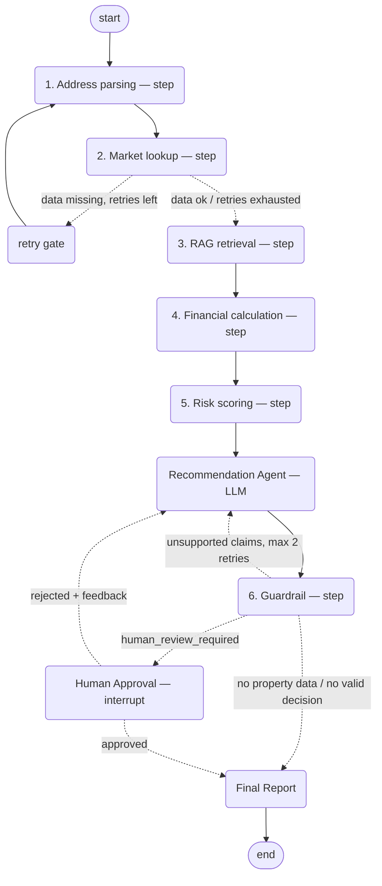

# Property AI - Indian Property Investment Advisor

A LangGraph-based property investment advisor for the Indian real estate market.
Given a property address, INR budget, horizon, strategy and loan terms, it produces a
BUY / HOLD / AVOID recommendation, checks every cited figure against the computed data,
and requires human approval before generating reports.

Ships with:

- CLI: `main.py`
- FastAPI backend: `app.py`
- Static frontend: `frontend/index.html`

All entry points use the same LangGraph workflow.

> **Demo data.** The 35 properties and 34 market/risk localities in
> `src/property_advisor/data/mock_*.json` are **synthetic** — made up to exercise the demo
> scenarios, not taken from any listing or survey. Recommendations are only as good as that
> data; do not use them for real investment decisions.

## Architecture

The graph has **one LLM agent** (the Recommendation Agent, Groq) and **six deterministic
steps**, plus three control nodes (retry counter, human review, final report). Everything
except the Recommendation Agent is plain Python: no LLM decides routing, computes numbers
or checks claims.



| Node | Kind | What it does |
|---|---|---|
| `parse_address_step` | deterministic | Parses the address, looks up the property in mock data |
| `market_lookup_step` | deterministic | Looks up locality appreciation, rent and demand/supply |
| `rag_retrieval_step` | deterministic | Top-k vector search over the document corpus (ChromaDB, local embeddings) |
| `financial_calc_step` | deterministic | ROI, yields, cap rate, EMI and cash flow using the given LTV / rate / tenure |
| `risk_scoring_step` | deterministic | 0-100 risk score from vacancy/crime/flood/regulatory/volatility indicators |
| `recommendation_agent` | **LLM (Groq)** | BUY/HOLD/AVOID, justification, structured evidence, confidence; skipped when there is no property data |
| `guardrail_step` | deterministic | Rule checks + claim check; routes to re-analysis, refusal or human review |

Each node is logged with its name, input/output summary and execution time
(`logs/project.log`) and traced as its own LangSmith span when tracing is enabled.

### Guardrail

**Claim check.** The Recommendation Agent must return each piece of supporting evidence as
`{metric, cited_value, statement}`, where `metric` is one of a fixed set
(`schemas.EVIDENCE_METRIC_FIELDS`) mapped to a `PropertyState` field — `roi_pct`,
`rental_yield_pct`, `cap_rate_pct`, `annual_cash_flow_inr`, `unlevered_annual_cash_flow_inr`,
`break_even_years`, `cash_flow_severity`, `risk_score`, `appreciation_rate_5yr_pct`,
`price_inr` — or `rag_source` (must be a retrieved filename). The guardrail compares each
cited value to the computed one: numbers must be within 2% or ±0.5 (whichever is looser),
strings must match exactly, and unknown metric names count as unsupported. Unsupported
claims trigger re-analysis (max 2 retries); claims still unsupported after that go to the
human reviewer as `unverified_claims`, shown in the API response and in the report.

**Free-text check** (`steps/text_claims.py`). The justification and every evidence
statement are also checked, clause by clause, for directional claims: cash-flow sign
("positive cash flow" — read as *after EMI* unless it says "operating"/"before loan"),
risk level (overall score or a named factor such as flood), and yield level or comparison
with the market average. Comparisons to any benchmark not in state ("above the local
average ROI") count as unverified. This is keyword matching: it catches the common
wrong-direction phrasings, not every possible one.

**Leverage rule** (by monthly shortfall after EMI, as a % of the EMI):
- above `LEVERED_SHORTFALL_WARN_PCT_OF_EMI` (25%): a warning with both cash-flow figures is
  always appended (all 34 mock properties with market data, at 51–87%);
- above `LEVERED_SHORTFALL_CAP_PCT_OF_EMI` (70%): confidence is also capped at
  `LEVERED_SHORTFALL_CONFIDENCE_CAP` (0.75) and BUY is downgraded to HOLD unless
  `strong_appreciation_evidence` is true (6 properties: Dwarka, Kothrud, Thane West, Dadar,
  Andheri West, Worli).

**Hurdle-rate rule.** If IRR on equity is below `HURDLE_RATE_PCT` (unset = the loan
interest rate, i.e. the cost of debt) the leverage destroys value: BUY is downgraded to
HOLD, or AVOID if IRR < 0, and the note "Leverage destroys value: IRR X% < cost of debt Y%"
is always added (justification and guardrail notes; the UI shows "below/above Y% cost of
debt" under the IRR tile). The model is told the rule and gets `hurdle_rate_pct`,
`irr_minus_hurdle_pct` and `irr_below_hurdle`. At the default 9% it applies to 23 of the 34
mock properties with market data (e.g. Whitefield: IRR 8.84% → HOLD; at
`--interest-rate 8` its IRR is 10.65% > 8% and BUY is possible). It runs before the
leverage cap, and every property above the 70% shortfall level currently has a negative
IRR.

**Rule checks (7 of 8 active):** missing property data (→ refuse), missing market data,
risk score above threshold, negative operating cash flow, shortfall after EMI above the
leverage threshold, IRR below the hurdle rate, confidence below threshold. The eighth, the
conflicting-evidence check, is **disabled**: it matched two AI-written Hinjewadi analyst notes that are no
longer in the corpus and needs redesigning for real documents.

**Cash-flow terms.** *Operating cash flow* = rent − 25% operating expenses, before the loan
(`operating_cash_flow_inr`). *Cash flow after EMI* = operating cash flow − 12 × EMI
(`cash_flow_after_emi_inr`; the older `annual_cash_flow_inr` is the same figure). *Total
return on price over N years* (the original ROI) =
(appreciation gain + N × cash flow after EMI) ÷ price. *Return on equity over N years* =
(appreciation gain + N × cash flow after EMI + loan principal repaid by year N − stamp duty
& registration) ÷ equity invested, where equity = down payment + stamp duty & registration
(`STAMP_DUTY_REGISTRATION_PCT`, default 6% of price; it is spent, never recovered, so it
also reduces the gain); shown with its compound annual rate. *IRR on equity* = annualised
internal rate of return of the buyer's monthly flows: −equity at month 0, cash flow after
EMI every month, + (sale price − outstanding loan) at month N×12 — lower than annualised
ROE when there is a monthly shortfall, because that shortfall is extra money put in over
time. Example (Whitefield, mock 9.2%/yr appreciation, 80% LTV, 9%, 20 yrs): equity ₹24.7L,
principal repaid over 5 years ₹8.58L, ROE 121.9% (17.3%/yr), IRR 12.97%/yr.

**Confidence cap.** The final confidence never exceeds the metrics' `data_quality_confidence`
(e.g. 0.85 when appreciation comes from the city-level HPI); a note is added when it is capped.

**Appreciation rate.** Taken from the RBI House Price Index (`data/rbi_hpi.csv`, base
2022-23 series only): annualised growth over the last `HPI_WINDOW_QUARTERS` (12) quarters
for the property's city. It is city-level, so data quality confidence is capped at
`HPI_CITY_LEVEL_CONFIDENCE` (0.85), and windows that include provisional quarters are
flagged. The rate is cross-checked against the longest available window (Q1 2022-23 to
the latest quarter); if they differ by more than `HPI_VOLATILITY_THRESHOLD_PTS` (4) points
it is flagged **volatile** in the guardrail notes and report and never counts as strong
appreciation evidence (currently Chandigarh, Lucknow, Nagpur). Cities without an HPI series
(Gurgaon, Navi Mumbai, Surat, Indore, Bhubaneswar, Goa, Coimbatore, Dehradun; Zirakpur,
which is in Mohali district) fall back to the synthetic mock rate, labelled as such in the
guardrail notes and the report.

**Missing market data.** If market data is still missing after the data retries, the
rent- and appreciation-dependent metrics (yield, cash flows, total return, ROE, IRR) are
marked unavailable (`None`, shown as N/A) instead of being computed from zero rent; the
cash-flow, leverage and hurdle rules are skipped, and the Recommendation Agent returns
HOLD with "Insufficient market data" without calling the LLM (confidence 0.3, human review
still required).

**Outcomes:** refuse (no property data, or no decision/justification) · re-analyse
(unsupported claims, retries left) · human review (everything else — approval is always
required before a report).

## Data

- `src/property_advisor/data/mock_properties.json`, `mock_market_trends.json`,
  `mock_risk_data.json` — **synthetic** demo data (see note above).
- `src/property_advisor/data/rag_corpus/*.txt` — RAG corpus converted from official and
  secondary documents (below).
- `src/property_advisor/data/rbi_hpi.csv` — RBI House Price Index, city × quarter
  (`city, quarter, index_value, base_year, provisional`); three series with base years
  2008-09, 2010-11 and 2022-23, which must not be mixed. The market step uses the 2022-23
  series for appreciation rates (see Guardrail › Appreciation rate).
- `src/property_advisor/data/rag_corpus_legacy/` — the original AI-written notes, kept for
  reference only; not indexed.

### RAG corpus

Ten documents (~27,600 words, 253 chunks at 800 characters with 100 overlap):

| File | Source | Type |
|---|---|---|
| `rbi_housing_finance_master_circular_2014.txt` | RBI Master Circular – Housing Finance, 2014 | primary, **withdrawn** |
| `rbi_ltv_circular_2012.txt` | RBI LTV circular, 2012 | primary, **withdrawn** |
| `rbi_ltv_riskweights_circular_2015.txt` | RBI LTV / risk-weight circular, 2015 | primary, **withdrawn** |
| `rbi_hpi_press_release_*.txt` (3) | RBI House Price Index press releases, Q3 2025-26 to Q1 2026-27 | primary |
| `income_tax_house_property.txt` | Income Tax Department, house property pages | primary |
| `model_tenancy_act_2021_prs.txt` | PRS Legislative Brief on the Model Tenancy Act, 2021 | secondary |
| `rera_act_2016_explainer.txt` | iPleaders blog explainer on RERA, 2016 | secondary |
| `ndma_urban_flooding_excerpt.txt` | NDMA Urban Flooding Guidelines (buyer-relevant sections) | primary |

Provenance, URLs, what was trimmed from each, and known gaps (official RERA Act text,
current RBI housing-finance rules, Karnataka RERA Rules) are in
[`rag_corpus/sources.md`](src/property_advisor/data/rag_corpus/sources.md). The withdrawn
RBI circulars start with a "WITHDRAWN / SUPERSEDED" line and must not be quoted as current
limits. To rebuild the corpus and `rbi_hpi.csv` from the PDFs in `raw_docs/`, run
`scripts/corpus/build.sh` (see [`scripts/corpus/README.md`](scripts/corpus/README.md)).

Retrieval settings are configurable via `.env`: `RAG_CHUNK_SIZE` (800), `RAG_CHUNK_OVERLAP`
(100), `RAG_TOP_K` (4). The index lives in `chroma_db/` and is rebuilt automatically when
it is empty or the chunk settings change; delete `chroma_db/` after editing corpus files.

The app runs offline except for Groq calls. ChromaDB embeds locally; no embedding API key
is required (the embedding model is downloaded once on first use).

## Installation

Requires Python 3.11+.

```bash
python3.11 -m venv .venv
.venv/bin/pip install -r requirements.txt
cp .env.example .env
```

Add your Groq key to `.env`:

```bash
GROQ_API_KEY=...
```

Optional:

```bash
GROQ_MODEL=llama-3.3-70b-versatile
LANGSMITH_TRACING=false
LANGSMITH_API_KEY=...
```

## Run the CLI

```bash
.venv/bin/python main.py --address "Whitefield, Bangalore" --budget 9500000 \
  --horizon 5 --strategy rental --ltv 80 --interest-rate 9 --tenure 20
```

Omit flags to be prompted for address and budget. At the human-review step, approve or
reject the recommendation. Approval generates JSON, Markdown, and PDF reports under
`reports/`.

Useful flags:

- `--ltv`, `--interest-rate`, `--tenure` set the loan terms (defaults 80% / 9% / 20 years;
  LTV must be ≤ 90%, rate 0–25%, tenure 1–30 years).
- `--auto-approve` skips the approval prompt.
- `--no-reports` skips report generation.
- `--reports-dir <path>` changes the report destination.
- `--demo` runs fixed demo scenarios.

## Run the API and Frontend

```bash
.venv/bin/python app.py
```

Open `http://localhost:8080/`.

The browser flow mirrors the graph: analyze a property, review the recommendation and
guardrail reasons, then approve or reject. Approval generates downloadable reports.

Main endpoints:

- `POST /analyze` — `{address, budget, horizon?, strategy?, ltv?, interest_rate?, tenure?}`;
  invalid loan terms return 422. A pending response includes `thread_id` and
  `unverified_claims`.
- `POST /approve` — `{thread_id}`
- `POST /reject` — `{thread_id, feedback}`
- `GET /reports/{filename}`

## Reports

Generated reports include the property summary, market data, financial metrics and loan
assumptions, risk assessment, recommendation with structured evidence, unverified claims,
guardrail reasons, RAG sources, human decision, and timestamp.

```text
reports/<property_slug>.json
reports/<property_slug>.md
reports/<property_slug>.pdf
```

## Tests and Evals

Tests (no Groq key or network needed — the LLM is stubbed; retrieval tests use the local
Chroma index):

```bash
.venv/bin/python -m pytest tests/ -v
```

Evals are hand-checkable rules, each with a stated reason (`evals/scenarios.py`):

```bash
.venv/bin/python evals/run_deterministic.py   # no Groq key: metrics, risk, retry, refusal, cash-flow safety net
.venv/bin/python evals/run_llm.py             # needs GROQ_API_KEY: full graph, checks decisions the data rules out
```

Deterministic rules include: invalid address → refused; high flood risk → risk ≥ 80 and
human review; missing market data → retries exhausted; significantly negative operating cash
flow → a forced BUY is downgraded. LLM rules only forbid decisions the data rules out (e.g.
negative ROI → not BUY; high flood risk → not BUY). The conflicting-reports scenario is
skipped while the conflict check is disabled.

## Observability

Structured node and router logs are written to `logs/project.log`.

LangSmith tracing is optional. Set `LANGSMITH_TRACING=true` and `LANGSMITH_API_KEY`
in `.env` to enable it.

## Known limitations

- **Free-text claim check is keyword-based.** `steps/text_claims.py` matches common
  phrasings of cash-flow sign, risk level and yield level/comparison. It does not
  understand language: unusual wording slips through, and a sentence that compares yield
  to the market average can carry an unchecked benchmark claim about something else (e.g.
  "equity return and yield exceed market averages").
- **Appreciation is city-level.** The RBI House Price Index is published per city, not per
  locality, so every property in a city gets the same rate (confidence capped at 0.85).
  The 2022-23 base series is only 17 quarters long, the latest quarter is provisional, and
  nine localities fall back to synthetic mock rates.
- **Fixed 25% operating-expense ratio.** Operating expenses are always 25% of rent, so
  operating cash flow (before the loan) can never be negative and the "operating loss → no
  BUY" rule never fires on real data (its eval overrides the metric to test it).
- **No selling costs or capital gains tax.** Total return, ROE and IRR assume the
  property is sold at the projected value with no brokerage, transfer costs or tax. Stamp
  duty & registration on purchase is included (6% default).
- **Conflicting-evidence check is disabled.** It matched two AI-written analyst notes
  that are no longer in the corpus; it needs redesigning for real documents (7 of 8 rule
  checks are active).
- **Corpus gaps.** No official RERA Act text (only a blog explainer), no current RBI
  housing-finance rules (the three RBI LTV/housing documents are withdrawn and marked
  as such), no Karnataka RERA Rules, and the house-property tax pages cite Income-tax Act
  1961 section numbers. See `rag_corpus/sources.md`.
- **Synthetic property, rent and risk data.** See the note at the top.

## Changes from the original group version

- **Honest naming.** The five tool-based nodes were called "agents"; they are deterministic
  steps and are now named and documented as such (`steps/`). The guardrail no longer uses
  an LLM, so it is a step too. The only LLM agent is the Recommendation Agent. Log records
  use `node_name` instead of `agent_name`.
- **Deterministic claim checking.** `supporting_evidence` changed from free-text strings to
  `{metric, cited_value, statement}` items. The Groq-based claim audit was replaced by code
  that compares cited values with computed ones. Claims still unsupported after two
  re-analyses reach the reviewer as `unverified_claims` instead of blocking the run.
- **Refusal on unknown addresses.** When no property data is found after the data retries,
  the Recommendation Agent skips its LLM call and the guardrail refuses.
- **Loan inputs.** LTV, interest rate and tenure are inputs (CLI, API, validated state)
  instead of hard-coded 80% / 9% / 20 years; the prompt and report use the actual terms.
- **RAG.** The eight AI-written corpus notes were replaced with ten documents converted from
  official/secondary sources (see `sources.md`); old notes moved to `rag_corpus_legacy/`.
  Chunk size, overlap and top-k are configurable; the retrieval step now uses k=4 (was 6).
  RBI House Price Index data was parsed to `rbi_hpi.csv`.
- **Conflict check disabled.** It depended on the removed Hinjewadi notes.
- **Evals.** Expectations are now rules with reasons rather than exact LLM decisions, split
  into a deterministic suite (no key, also run by pytest) and an LLM suite.
- **Tests.** Added stubbed-LLM tests for the graph (retry gate, re-analysis loop,
  approve/reject, refusal), the API, the claim checker, loan inputs, and retrieval
  assertions for five reference queries.
- **Frontend.** Renders structured evidence statements; header text changed from
  "Multi-agent" to "AI-assisted".
